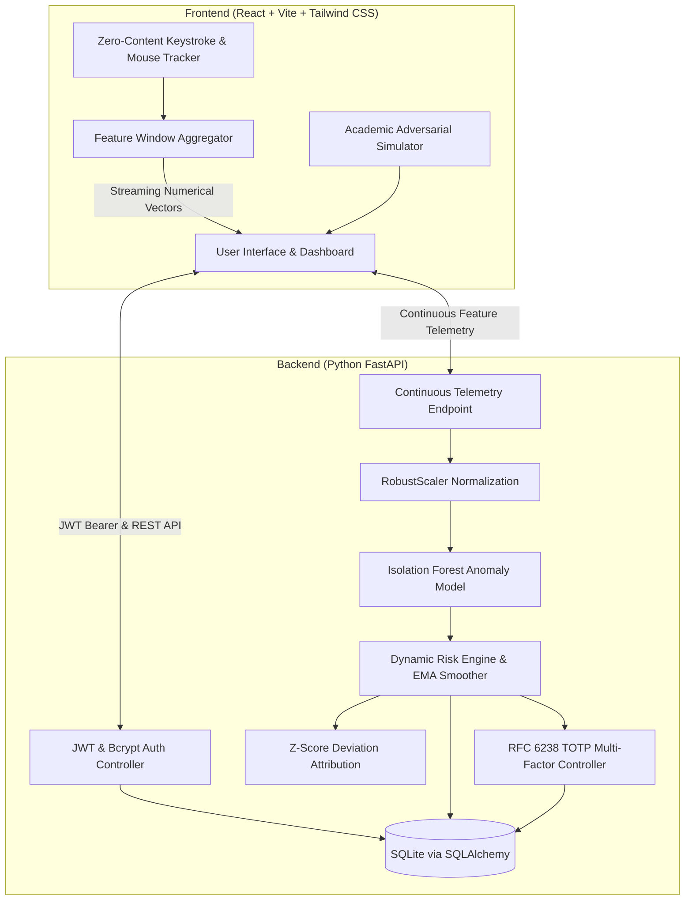

# AI-Based Continuous Authentication Using Behavioral Biometrics

An academic and production-ready continuous authentication platform that verifies user identity dynamically in real time based on keystroke dynamics, mouse kinematics, and interaction cadence using **scikit-learn Isolation Forests**, **FastAPI**, **SQLite**, and **React + Tailwind CSS**.

---

## 1. System Architecture



---

## 2. Core Concepts & Mathematical Formulations

### 2.1 Zero-Content Privacy Guarantee
Traditional keyloggers record typed text or credentials, creating severe privacy risks. This system enforces a **Zero-Content Privacy Guarantee**:
- **Never records `event.key`, `event.code`, text strings, or form values.**
- Only collects **relative millisecond timing intervals** and **cursor kinematics**.

### 2.2 Feature Space (14 Numerical Features)

| Feature Name | Symbol | Description | Mathematical Formulation |
| :--- | :---: | :--- | :--- |
| `mean_hold_time` | $\mu_{hold}$ | Average key depression duration | $\frac{1}{N}\sum (T_{keyup} - T_{keydown})$ |
| `std_hold_time` | $\sigma_{hold}$ | Hold time variance | $\sqrt{\frac{1}{N}\sum (H_i - \mu_{hold})^2}$ |
| `mean_flight_time` | $\mu_{flight}$ | Inter-key transition latency | $\frac{1}{M}\sum (T_{keydown, i} - T_{keyup, i-1})$ |
| `std_flight_time` | $\sigma_{flight}$ | Rhythmic typing consistency | $\sqrt{\frac{1}{M}\sum (F_i - \mu_{flight})^2}$ |
| `typing_speed_cpm` | $CPM$ | Keystrokes per minute | $\frac{\text{Keys Count}}{\Delta t_{\text{sec}}} \times 60$ |
| `pause_ratio` | $R_{pause}$ | Ratio of pauses ($>400\text{ms}$) | $\frac{\text{Count}(F_i > 400)}{\text{Total Transitions}}$ |
| `mean_velocity` | $\mu_v$ | Average cursor speed | $\frac{1}{K}\sum \frac{\sqrt{\Delta x^2 + \Delta y^2}}{\Delta t}$ |
| `max_velocity` | $v_{max}$ | Peak burst speed | $\max_i (v_i)$ |
| `mean_acceleration`| $\mu_a$ | Acceleration magnitude | $\frac{1}{K}\sum \left\|\frac{\Delta v}{\Delta t}\right\|$ |
| `mean_jerk` | $\mu_j$ | Kinematic tremor/smoothness | $\frac{1}{K}\sum \left\|\frac{\Delta a}{\Delta t}\right\|$ |
| `curvature_ratio` | $C$ | Trajectory straightness ratio | $\frac{\sum \text{Arc Segment Length}}{\text{Euclidean Distance}(P_0, P_n)}$ |
| `mean_click_duration` | $\mu_{click}$ | Click depression time | $\frac{1}{C}\sum (T_{mouseup} - T_{mousedown})$ |
| `movement_to_click_ratio` | $R_{mc}$ | Move strokes per click | $\frac{\text{Move Events}}{\text{Click Events}}$ |
| `scroll_intensity` | $I_{scroll}$ | Accumulated wheel displacement | $\frac{\sum \|\Delta y_{wheel}\|}{\Delta t_{\text{sec}}}$ |

### 2.3 Isolation Forest Anomaly Detection
An ensemble of 100 random decision trees recursively isolates observations. Outliers and anomalous profiles are isolated closer to the root of the tree:
$$s(x, n) = 2^{-\frac{E(h(x))}{c(n)}}$$
Where $E(h(x))$ is average path length, and $c(n)$ is average path length of unsuccessful searches in a Binary Search Tree.

### 2.4 Calibrated Risk Scoring (0 to 100)
Raw Isolation Forest scores $s \in [-0.5, 0.5]$ are monotonically mapped to a calibrated Risk Score ($0\%$ to $100\%$) using a calibrated sigmoid function:
$$R_{instantaneous} = \frac{100}{1 + e^{-k \cdot (s - s_0)}}$$
Where $s_0 = 0.035$ represents the calibrated decision boundary, and $k = 16.0$ controls sigmoid steepness.
- Inliers ($s > +0.15$): Risk Score $\approx 5\% - 25\%$ (Authentic).
- Borderline ($s \approx 0.035$): Risk Score $\approx 50\%$ (Warning).
- Outliers ($s < -0.10$): Risk Score $\approx 85\% - 99\%$ (Anomaly Breach).

### 2.5 Exponential Moving Average (EMA) Smoothing
To prevent transient hiccups (e.g. coughing or momentary distraction) from creating false alarms while rapidly detecting persistent divergence:
$$R_t = \alpha \cdot R_{\text{instantaneous}} + (1 - \alpha) \cdot R_{t-1}$$
With $\alpha = 0.35$.

### 2.6 Dynamic Risk Threshold Policy
- **Low Risk ($\le 40\%$)**: Authentic user. All actions permitted.
- **Medium Risk ($41\% - 70\%$)**: Warning state. Elevated telemetry monitoring.
- **High Risk ($> 70\%$)**: Critical anomaly. Session restricted, sensitive operations blocked, mandatory step-up TOTP MFA verification challenge.

---

## 3. Project Structure

```
ai-continuous-auth/
├── backend/
│   ├── app/
│   │   ├── api/v1/
│   │   │   ├── auth.py             # User registration, login, JWT & consent
│   │   │   ├── biometric.py        # Enrollment submission & baseline training
│   │   │   ├── telemetry.py        # Real-time continuous scoring & history
│   │   │   ├── mfa.py              # TOTP setup, activation & session recovery
│   │   │   └── actions.py          # Risk-gated sensitive operations & audit log
│   │   ├── core/
│   │   │   ├── security.py         # Bcrypt, PyJWT, PyOTP, QRCode generator
│   │   │   └── dependencies.py     # Auth bearer & session dependencies
│   │   ├── ml/
│   │   │   ├── feature_extraction.py # Statistical vector definitions & bounds
│   │   │   ├── model.py            # Isolation Forest training, storage & inference
│   │   │   ├── risk_engine.py      # Calibrated 0-100 risk score & EMA smoothing
│   │   │   ├── explainability.py   # Z-score feature deviation decomposition
│   │   │   └── synthetic_benchmarks.py # Benchmark datasets (ROC, AUC, FAR/FRR)
│   │   ├── models/                 # SQLAlchemy User, Session, Telemetry & Audit
│   │   ├── schemas/                # Pydantic input/output schemas
│   │   ├── config.py               # Pydantic settings & CORS configuration
│   │   ├── database.py             # SQLite connection & sessionmaker
│   │   └── main.py                 # FastAPI application root
│   ├── tests/                      # Pytest automated test suite
│   ├── verify_e2e.py               # 9-stage automated end-to-end audit script
│   ├── requirements.txt            # Python dependencies
│   └── .env.example
└── frontend/
    ├── src/
    │   ├── biometrics/             # Zero-content keyboard & mouse trackers
    │   ├── components/             # RiskGauge, TelemetryCharts, ExplainabilityCard,
    │   │                           # EnrollmentModal, MFAModal, ImpostorSimulator
    │   ├── context/                # AuthContext & BiometricContext
    │   ├── pages/                  # DashboardPage, ModelEvaluationPage, Login, Register
    │   ├── services/api.js         # Axios client with JWT interceptors
    │   ├── App.jsx                 # Main application controller
    │   └── main.jsx
    ├── package.json
    ├── vite.config.js
    └── tailwind.config.js
```

---

## 4. Setup & Installation

### Prerequisites
- Python 3.10+ (Tested on Python 3.13)
- Node.js 18+ & npm (Tested on Node v22)

### Backend Setup
1. Open a terminal in `backend/`:
   ```bash
   cd backend
   python -m venv venv
   ```
2. Activate virtual environment:
   - **Windows**: `.\venv\Scripts\activate`
   - **Linux/macOS**: `source venv/bin/activate`
3. Install dependencies:
   ```bash
   pip install -r requirements.txt
   ```
4. Start FastAPI server:
   ```bash
   uvicorn app.main:app --host 127.0.0.1 --port 8000 --reload
   ```
   API interactive documentation is live at `http://127.0.0.1:8000/docs`.

### Frontend Setup
1. Open a terminal in `frontend/`:
   ```bash
   cd frontend
   npm install
   ```
2. Start Vite development server:
   ```bash
   npm run dev
   ```
   Access the dashboard at `http://localhost:5173`.

---

## 5. Automated Verification & Testing

### Running Unit Tests (pytest)
Execute the complete test suite from the `backend/` directory:
```bash
pytest -v tests
```
Tests cover:
- User registration and JWT authentication
- Zero-content feature extraction and bounds enforcement
- Isolation Forest model training and inference
- EMA risk score smoothing and threshold state changes
- Step-up TOTP verification and sensitive action gating

### Running Live End-to-End Audit Script
With the FastAPI server running on port 8000:
```bash
python verify_e2e.py
```
This executes all 9 stages in sequence:
1. Health check verification.
2. User registration with bcrypt hashing.
3. Login & JWT session creation.
4. Privacy consent recording.
5. Guided enrollment of 20 behavioral windows & model training.
6. Empirical benchmark evaluation (ROC AUC & Confusion Matrix).
7. Execution of low-risk sensitive operation (Approved).
8. Synthetic adversarial attack injection & EMA risk escalation (> 70%).
9. Risk-gating blocking (HTTP 403) $\to$ TOTP MFA challenge verification $\to$ Session recovery & re-execution.

---

## 6. Live Project Demonstration Guide

1. **Register & Log In**:
   - Open `http://localhost:5173`.
   - Register a new account or sign in.
2. **Complete Biometric Enrollment**:
   - Click "Start Guided Enrollment".
   - Review and accept the Zero-Content Privacy Consent.
   - Type the passages naturally.
   - Complete the 6-point mouse calibration targets.
   - The system fits an Isolation Forest model and displays your baseline profile.
3. **Monitor Live Interaction**:
   - The Speedometer Risk Gauge displays your current risk score (typically $5\% - 25\%$).
   - The real-time trajectory chart plots rolling evaluation windows.
   - The Explainability card details feature-level Z-score attributions.
4. **Simulate Adversarial Attacks**:
   - In the "Adversarial Simulation Lab", click **Scripted Bot** or **Foreign Typist**.
   - Watch the Risk Score smoothly escalate past the $70\%$ threshold in real time.
   - Notice the Explainability card flagging exact anomalies (e.g. *Key flight latency elevated by 280%*).
5. **Test Risk-Gated Operations**:
   - Attempt to execute the "Wire Transfer" or "Export Confidential Transcripts".
   - The system blocks the operation with **Security Policy Violation (403 Forbidden)**.
6. **Session Recovery with TOTP MFA**:
   - Enter your 6-digit Authenticator code (or emergency backup code).
   - Upon verification, the session risk resets to $5.0\%$ baseline and operations unlock.
7. **View Academic Model Evaluation**:
   - Click the "Model Evaluation" tab in the navbar.
   - Inspect the empirical ROC curve, AUC score, Accuracy, False Acceptance Rate (FAR), and False Rejection Rate (FRR).
